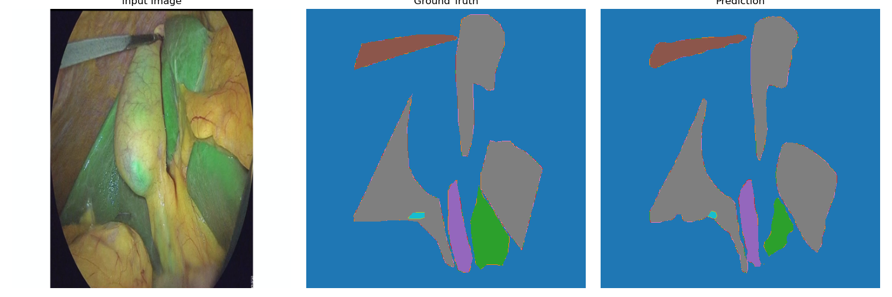

# Cystic Landmark Segmentation for Laparoscopic Cholecystectomy

Deep learning segmentation of critical anatomical landmarks during laparoscopic cholecystectomy, with the goal of reducing bile duct injury (BDI).

This repository is already hosted at [github.com/siriluo/cystic_segmentation](https://github.com/siriluo/cystic_segmentation).

## Clinical motivation

Despite improvements in surgical technique, the rate of BDI has remained on the order of **0.4%** over the past decade. Roughly **60%** of major injuries are Stewart–Way class III events, in which the common bile duct is misidentified as the cystic duct and transected [1,2]. This project aims to assist surgeons by highlighting gallbladder-region anatomy in laparoscopic video.

The first phase is a curated, expert-annotated dataset of laparoscopic cholecystectomy frames. The model is trained to segment:

1. Gallbladder
2. Cystic duct
3. Cystic artery
4. Common bile duct
5. Liver edge
6. Surgical instruments
7. Rouvière's sulcus *(present in the annotations; used as an additional landmark)*

At inference time, predicted masks are overlaid on video to provide visual guidance. The longer-term aim is to support intraoperative decision-making and reduce misidentification-related injury [3].

Frames include both white-light laparoscopy and indocyanine green (ICG) fluorescence imaging of biliary anatomy.

## Repository layout

```
.
├── cystic_seg/              # Installable package (dataset, model, metrics, viz)
├── scripts/
│   ├── train.py             # Training with early stopping
│   ├── validate.py          # Per-class IoU on the held-out split
│   ├── infer.py             # Video overlay inference
│   ├── chunk_video.py       # Clip a video by timestamp
│   ├── preview_dataset.py   # Rasterize and plot a few masks
│   └── train.sh             # Example training launch
├── configs/default.yaml     # Documented hyperparameters
├── notebooks/               # Annotation exploration
├── assets/                  # Example image + VIA JSON (no patient series)
├── data/                    # Local cases (gitignored; see data/README.md)
└── experiments/             # Logs, plots, and checkpoints
```

## Setup

```bash
python -m venv .venv
source .venv/bin/activate
pip install -r requirements.txt
pip install -e .                 # optional; scripts also work via PYTHONPATH
```

On a GPU cluster, install the PyTorch build that matches the local CUDA toolkit, then install the remaining requirements.

## Data

Put case folders under `data/` as described in [`data/README.md`](data/README.md). Surgical video and per-frame annotations are **not** committed.

Annotation files follow the VIA JSON format. The loader accepts the historical typo `Gallbradder` as `Gallbladder`. Retrain if you previously trained with the old `dataset.py`, which dropped that label.

## Training

```bash
python scripts/train.py \
  --data-root ./data \
  --experiment-dir ./experiments \
  --batch-size 16 \
  --epochs 50 \
  --lr 1e-4
```

Or:

```bash
bash scripts/train.sh
```

The default model is DeepLabV3-ResNet50 (ImageNet / COCO initialization) with an 8-class head (background + 7 landmarks), Adam, `CrossEntropyLoss`, `ReduceLROnPlateau`, and early stopping on validation loss.

## Evaluation

```bash
python scripts/validate.py \
  --data-root ./data \
  --checkpoint experiments/deeplabv3_best.pth
```

Uses the same 80/20 split and seed as training (`--seed 42`).

## Inference

Clip a segment, then overlay predictions on every frame (ffmpeg extract → model → stitch). OpenCV is not required.

```bash
module load ffmpeg/6.1.1   # DeltaAI

python scripts/chunk_video.py input.mp4 outputs/clip.mp4 00:43:00 00:44:00

python scripts/infer.py \
  --video chunked_video.mp4 \
  --checkpoint experiments/train_test/deeplabv3_best.pth \
  --task landmarks \
  --output outputs/chunked_video_segmented.mp4
```

On a GPU node:

```bash
sbatch scripts/infer.sbatch
```

`--task` must match the checkpoint (`landmarks` = 8-class, `bile-ducts` = 4-class, `ducts-only` = 3-class). Use `--keep-frames` to retain the JPEG folders, `--max-frames N` to process a prefix.

## Example results

A short training run on the current local cases (Case 43–45) is stored under `experiments/`. Qualitative overlays:

| Input / GT / prediction |
| --- |
|  |

Inspect masks before training:

```bash
python scripts/preview_dataset.py --data-root ./data --n 5
```

## Future work

- Stronger real-time models (and latency measurement on surgical workstations)
- Broader multi-center data and expert review of labels
- Clinical validation and integration with the laparoscopic display
- Optional ICG vs white-light domain handling

## References

1. Pucher PH, Brunt LM, Fanelli RD, Asbun HJ, Aggarwal R. SAGES expert Delphi consensus on prevention of bile duct injuries during laparoscopic cholecystectomy. *Surg Endosc*. 2015. Related series report BDI remaining near 0.3–0.5% despite technical advances.
2. Way LW, Stewart L, Gantert W, et al. Causes and prevention of laparoscopic bile duct injuries: analysis of 252 cases from a human factors and cognitive psychology perspective. *Ann Surg*. 2003;237(4):460-469. Stewart–Way class III (common duct mistaken for cystic duct) accounts for about 60% of major injuries; most events are visual misperception rather than technical error.
3. Mascagni P, Vardazaryan A, Alapatt D, et al. Artificial intelligence for surgical safety: automatic assessment of the critical view of safety in laparoscopic cholecystectomy using deep learning. *Ann Surg*. 2022;275(5):955-961.

## License

Research code. Dataset and videos remain with the clinical collaborators and are not redistributed through this repository.
